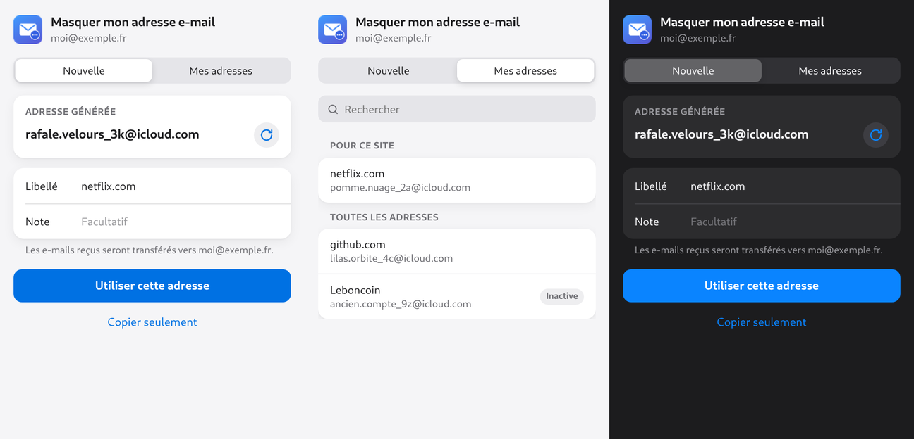

# Hide My Email pour Chrome, via rclone

Crée des adresses **iCloud+ Hide My Email** (« Masquer mon adresse e-mail »)
depuis Chrome sous Linux, **sans se connecter à iCloud dans le navigateur** :
l'extension réutilise la session iCloud que [rclone](https://rclone.org) a
déjà ouverte pour monter iCloud Drive.



- **Bouton de l'extension** : une adresse est proposée, le libellé est déjà
  rempli avec le site ouvert. « Utiliser cette adresse » la réserve, la met
  dans le champ e-mail de la page et la copie. ↻ en propose une autre.
- **Mes adresses** : toutes vos adresses, celles du site ouvert en premier,
  recherche, un clic pour copier.
- **Clic droit dans un champ** → « Masquer mon adresse e-mail ici » : crée,
  réserve, remplit et copie en un geste.
- Thème clair et sombre automatiques.

## Pourquoi passer par rclone

Les extensions existantes lisent les cookies d'icloud.com dans le navigateur ;
cette session expire souvent et il faut se reconnecter. rclone garde une
session iCloud avec un jeton de confiance de 30 jours, entretenue tant que le
montage tourne : une seule connexion sert au montage et à l'extension.

## Prérequis

- Un abonnement **iCloud+**.
- **rclone ≥ 1.69** avec un remote de type `iclouddrive` nommé `icloud`
  (`rclone config create icloud iclouddrive`), connecté. Un autre nom :
  variable `HME_RCLONE_REMOTE` dans l'environnement de Chrome.
- Sur l'iPhone : « Accéder aux données iCloud sur le Web » activé (requis par
  rclone, y compris avec la Protection avancée des données).
- Python 3 et un navigateur Chromium (Chrome, Chromium, Brave, Edge, Vivaldi).

## Installation

```sh
./install.sh
```

Puis `chrome://extensions` → Mode développeur → « Charger l'extension non
empaquetée » → dossier `extension/`. L'identifiant de l'extension est fixe
(tiré de la clé publique du manifest) : le relais déclaré par `install.sh`
le reconnaît.

## Fonctionnement

```
Extension Chrome ──native messaging──► native-host/hme-host (Python, sans dépendance)
                                          │ rclone config dump (lecture seule)
                                          ▼
                     setup.icloud.com/validate → premiummailsettings → /hme/…
```

- Le relais lit **seulement les cookies** du remote rclone, via
  `rclone config dump` : ça marche aussi avec une configuration rclone
  chiffrée (`RCLONE_PASSWORD_COMMAND`). Il ne lit pas le mot de passe Apple et
  **n'écrit jamais** la configuration rclone.
- Création et réservation : `v1/hme/generate` et `v1/hme/reserve` ; liste :
  `v2/hme/list` puis `v3`. Apple retire les anciennes versions (`v1/hme/list`
  répond déjà 410) : le relais passe à la suivante sur 404/405/410.
- Pas de désactivation ni de suppression d'adresse : à faire dans les réglages
  iCloud.

## Dépannage

| Message | Cause | Que faire |
|---|---|---|
| « Session iCloud expirée » | jeton rclone périmé (30 jours) | `rclone config reconnect icloud:` |
| « Le relais local ne répond pas » | relais non déclaré ou déplacé | relancer `./install.sh`, recharger l'extension |
| « rclone n'a pas pu fournir la session » | config chiffrée sans mot de passe disponible | définir `RCLONE_PASSWORD_COMMAND` |

Tester le relais sans Chrome :

```sh
printf '\x10\x00\x00\x00{"cmd":"status"}' | native-host/hme-host
```

## Limites

L'API Hide My Email d'Apple est **privée et non documentée** : elle peut
changer sans préavis. Ce projet n'est ni affilié, ni approuvé par Apple.

## Licence

MIT
